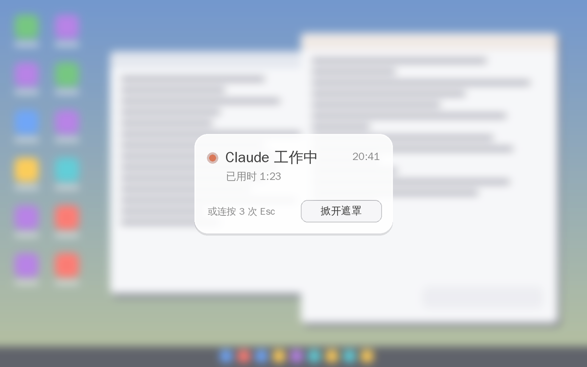

# Claude Screen Guard

[中文](README.md)

**When Claude starts working, your screen frosts over. When it's done, the frost fades and a soft chime calls you back.**

Don't want to watch an AI think and type line by line? Rather just see the result? That's what this little tool is for: skip the process, just get the outcome.



> ⚠️ This is an **unofficial** personal project, not affiliated with Anthropic. Claude is a trademark of Anthropic.

## Features

- **Automatic overlay** — when the Claude desktop app is responding, a soft frosted-glass layer covers the screen. You can see that things are moving, but not what they say.
- **Short replies stay uncovered** — the overlay only appears once a reply runs longer than 5 seconds (adjustable).
- **Done chime** — when Claude finishes, the frost fades out and a chime plays.
- **Status card** — "Claude is working", elapsed time, the current time, and a "Show screen" button.
- **Lift it anytime** — click the button on the card, or press Esc three times quickly.
- **Doesn't get in Claude's way** — the overlay is invisible to screenshots and click-through, so Claude's computer use keeps working. The card button only responds to your real mouse, never to Claude's simulated clicks.
- **Settings window** — double-click the tray icon to adjust blur, tint, card size, font, delay and more.
- **English and Chinese** — the UI follows your system language.

## Install

1. Download `ClaudeScreenGuard-Setup-x.x.x.exe` from [Releases](https://github.com/faithadam/ClaudeScreenGuard/releases/latest).
2. Run it (no admin rights needed). It starts with Windows by default.
3. An orange dot appears in the system tray (it may be hidden behind `^`).

> The installer isn't code-signed, so Windows SmartScreen may warn you. Click **More info → Run anyway**, or build it yourself from source (see below).

Prefer no installer? Download `ClaudeScreenGuard-portable-x.x.x.zip`, unzip, and run `ClaudeScreenGuard.exe`.

**Requirements:** Windows 10 version 2004 or later (Windows 11 recommended) and the Claude desktop app.

## Keeping the overlay during computer use (important)

During computer use, Claude hides any app you haven't granted it access to — including this overlay. To keep the overlay up:

1. Double-click the tray icon to open Settings and click **"Copy instruction for Claude"**.
2. In the Claude desktop app, go to **Settings → personal preferences**, paste the sentence, and save.
3. From then on, Claude includes ClaudeScreenGuard in its access request — just click Allow as usual.

If it isn't granted on some run, the overlay notices it was hidden and steps aside for that reply, so it never blocks Claude's view.

## Usage

| Action | How |
|---|---|
| Open settings | Double-click the tray icon, or right-click → Settings… |
| Lift the overlay now | Click "Show screen" on the card, or press Esc ×3 |
| Turn off temporarily | Tray → Pause |
| See what it looks like | Tray → Test (4 s) |
| Uninstall | Windows Settings → Apps → Claude Screen Guard → Uninstall |

## How it works

- **Is Claude responding?** It uses Windows UI Automation (the accessibility API that screen readers use) to look for the "Stop" button next to Claude's input box. Button present → responding; button gone → done. It doesn't depend on where Claude is installed and tries not to depend on the UI language. Checks run on a background thread so the UI never stalls.
- **Frosted glass:** twice a second it captures what's under the overlay, downsamples it, applies a Gaussian blur, a slight saturation boost and a light tint, then scales it back up. It only runs while the overlay is visible — roughly 10% of one CPU core.
- **Invisible to screenshots:** `SetWindowDisplayAffinity(WDA_EXCLUDEFROMCAPTURE)`.
- **Click-through:** a layered `WS_EX_TRANSPARENT` window. The card button uses a low-level mouse hook that ignores injected input (`LLMHF_INJECTED`).

All the code is in a single file: [`src/ClaudeScreenGuard.cs`](src/ClaudeScreenGuard.cs).

## Known limitations

- Works with the **Claude desktop app** on Windows only — not claude.ai in a browser.
- It relies on Claude's "Stop" button. If a Claude update breaks it (no overlay, or the overlay never lifts), open the log from the tray menu and attach `guard.log` to an [issue](https://github.com/faithadam/ClaudeScreenGuard/issues).
- The English button name is a best guess ("Stop response", plus any button starting with "Stop"). It was developed against the Chinese UI — if the English UI doesn't trigger it, please open an issue.
- If Windows "Transparency effects" are off, the "System acrylic" style turns solid gray. The default "Soft frosted glass" style isn't affected.

## Build from source

No Visual Studio needed — the C# compiler that ships with Windows is enough:

```bat
scripts\build.bat
```

The program ends up in `bin\ClaudeScreenGuard.exe`. The installer is built from `installer\ClaudeScreenGuard.iss` with [Inno Setup 6](https://jrsoftware.org/isinfo.php). Pushing a `v*` tag makes GitHub Actions build and publish a release.

## License

[MIT](LICENSE)
