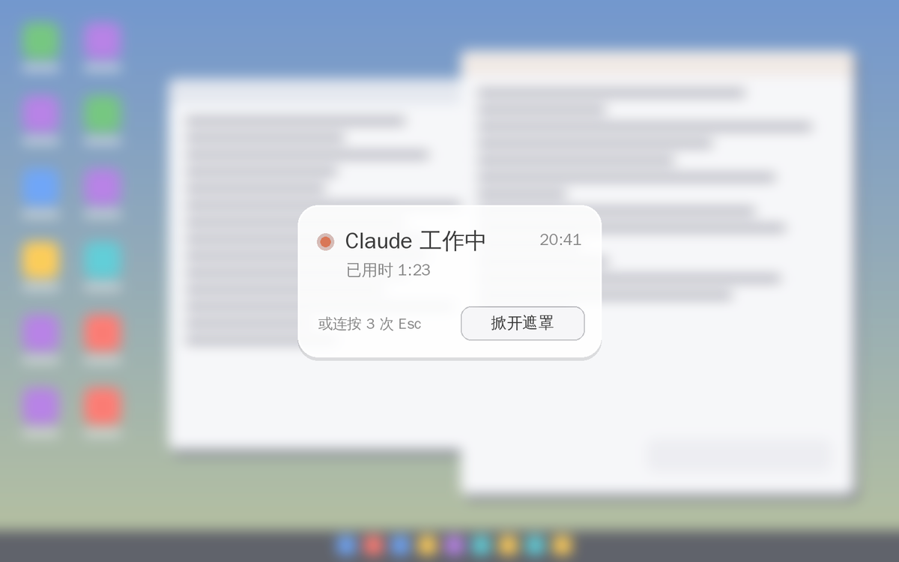

# Claude 屏幕遮罩（ClaudeScreenGuard）

[English](README.en.md)

**Claude 一开始干活，屏幕就盖上一层磨砂玻璃；干完了，玻璃慢慢褪去，"叮"一声叫你回来。**

不想盯着 AI 一遍遍思考、一行行输出？想等结果出来再看？这个小工具就是为此做的：不用看过程，只等结果。



> ⚠️ 这是**非官方**的个人项目，与 Anthropic 没有任何关系。Claude 是 Anthropic 的商标。

## 功能

- **自动遮罩**：检测到 Claude 桌面版正在回答，就盖上柔和的磨砂玻璃。能隐约看到后面在动，但看不清内容。
- **很快答完的不遮**：回答超过 5 秒才遮（可调），一两句话的回答不会闪一下。
- **完成提醒**：回答结束后磨砂慢慢淡出，并响一声提示音。
- **中间的小卡片**：显示"Claude 工作中"、已用时、当前时间，还有"掀开遮罩"按钮。
- **随时掀开**：点卡片上的按钮，或快速按 3 次 Esc。
- **不影响 Claude 操作电脑**：遮罩对截屏隐身、鼠标可穿透，Claude 使用电脑（computer use）时照样能看到、能点击。卡片按钮只响应你真实的鼠标，不会被 Claude 误点。
- **设置窗口**：双击托盘图标，用滑块调模糊程度、白雾浓度、卡片大小、字体、等待秒数等。
- **中英双语**：界面跟随系统语言。

## 安装

1. 到 [Releases](https://github.com/faithadam/ClaudeScreenGuard/releases/latest) 下载 `ClaudeScreenGuard-Setup-x.x.x.exe`。
2. 双击安装（不需要管理员权限）。默认会开机自启。
3. 右下角托盘出现橙色圆点图标，就说明在运行了（可能藏在 `^` 里）。

> 安装包没有数字签名，Windows 可能提示"已保护你的电脑"。点 **更多信息 → 仍要运行** 即可。不放心的话可以看源码自己编译（见下文）。

不想安装？下载 `ClaudeScreenGuard-portable-x.x.x.zip`，解压后直接运行 `ClaudeScreenGuard.exe`。

**系统要求**：Windows 10 2004 或更新版本（Windows 11 推荐），Claude 桌面版。

## Claude 操作电脑时也保持遮罩（重要）

Claude 使用电脑（computer use）时，会把**没授权给它的程序**藏起来。遮罩被藏起来，就失去作用了。为了让遮罩在这时也保持住：

1. 双击托盘图标打开设置，点 **"复制给 Claude 的授权提示语"**。
2. 打开 Claude 桌面版 → **设置 → 账户 → 个人偏好**，把复制的那句话粘贴进去，保存。
3. 以后 Claude 操作电脑时，授权框里会自动带上 ClaudeScreenGuard，你照常点"允许"就行。

如果某次没有授权，程序会识别到自己被藏起来了，主动让开这一次，保证不挡住 Claude 的视线。

## 使用

| 操作 | 方法 |
|---|---|
| 打开设置 | 双击托盘图标，或右键 → 设置… |
| 立刻掀开遮罩 | 点卡片上的"掀开遮罩"，或快速按 3 次 Esc |
| 临时关闭 | 托盘右键 → 暂停自动遮罩 |
| 看看效果 | 托盘右键 → 测试遮罩（4 秒） |
| 卸载 | Windows 设置 → 应用 → Claude Screen Guard → 卸载 |

## 它是怎么工作的

- **判断 Claude 是否在回答**：通过 Windows 的辅助功能接口（UI Automation，读屏软件用的就是它），在 Claude 窗口的输入框附近找"停止"按钮。按钮出现就是在回答，消失就是答完了。不依赖 Claude 的安装位置，也尽量不依赖界面语言。检查放在后台线程，不会让界面卡顿。
- **磨砂玻璃**：每秒截取 2 次遮罩下方的画面，先缩小、做高斯模糊、稍微提一点鲜艳度、叠一层白雾，再放大铺满屏幕。只在遮罩显示时运行，大约占一个 CPU 核心的 10%。
- **对截屏隐身**：用 `SetWindowDisplayAffinity(WDA_EXCLUDEFROMCAPTURE)`，截图和录屏里都看不到遮罩。
- **鼠标穿透**：遮罩是 `WS_EX_TRANSPARENT` 分层窗口。卡片按钮通过低级鼠标钩子只响应非模拟输入（`LLMHF_INJECTED` 标志）。

所有代码都在 [`src/ClaudeScreenGuard.cs`](src/ClaudeScreenGuard.cs) 一个文件里。

## 已知限制

- 只支持 **Claude 桌面版**（Windows），不支持浏览器里的 claude.ai。
- 依赖 Claude 界面里的"停止"按钮。Claude 更新界面后如果失灵（不遮或不掀开），请托盘右键 → 打开日志，把 `guard.log` 附在 [Issue](https://github.com/faithadam/ClaudeScreenGuard/issues) 里。
- 英文版 Claude 的按钮名称是按常见写法预设的，程序也会自动识别以 "Stop" 开头的按钮。如果英文界面不生效，欢迎反馈。
- 如果关闭了 Windows 的"透明效果"，"系统毛玻璃"样式会变成纯灰色；默认的"柔和磨砂"不受影响。

## 从源码编译

不需要安装 Visual Studio，Windows 自带的 C# 编译器就够了：

```bat
scripts\build.bat
```

生成的程序在 `bin\ClaudeScreenGuard.exe`。安装包用 [Inno Setup 6](https://jrsoftware.org/isinfo.php) 编译 `installer\ClaudeScreenGuard.iss`。推送 `v*` 标签时，GitHub Actions 会自动编译并发布。

## 许可证

[MIT](LICENSE)
